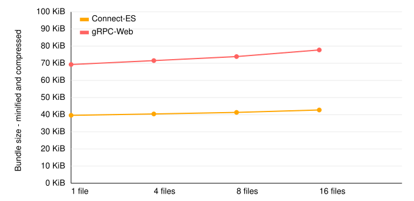

# Code size comparison

This is a simple code size comparison between Connect-ES and [gRPC-web](https://github.com/grpc/grpc-web).

We are generating code for the module [buf.build/bufbuild/registry](https://buf.build/bufbuild/registry)
once with gRPC-web, once with Connect-ES. Then we bundle a client calling an RPC
with [esbuild](https://esbuild.github.io/), minify the bundle, and compress it like a web server would
usually do. We repeat this for an increasing number of RPCs.

Tabular data

<!-- TABLE-START -->

| code generator | RPCs | bundle size |  minified | compressed |
| -------------- | ---: | ----------: | --------: | ---------: |
| Connect-ES     |    1 |   330,335 b | 197,522 b |   40,632 b |
| Connect-ES     |    4 |   334,587 b | 200,621 b |   41,357 b |
| Connect-ES     |    8 |   339,450 b | 205,050 b |   42,340 b |
| Connect-ES     |   16 |   348,578 b | 212,673 b |   43,789 b |
| gRPC-Web       |    1 | 1,088,277 b | 721,565 b |   70,927 b |
| gRPC-Web       |    4 | 1,139,666 b | 752,859 b |   73,266 b |
| gRPC-Web       |    8 | 1,215,077 b | 800,383 b |   75,677 b |
| gRPC-Web       |   16 | 1,333,848 b | 872,809 b |   79,626 b |

<!-- TABLE-END -->

